<div align="center">

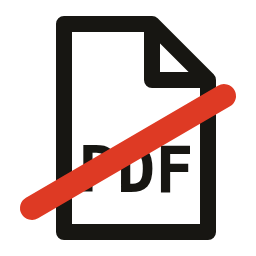

# IHatePDF

**Edit, compress, convert and fix PDFs — on your own computer.**<br>
28 PDF tools, plus sending files to a phone offline. Real text editing. No uploads, no accounts, no watermarks, no AI.

[](https://github.com/Burthcer/IHatePDF/releases/latest/download/IHatePDF-Setup.exe)

[](https://github.com/Burthcer/IHatePDF/releases/latest)


[](LICENSE)

**New in 1.4.0:** a local usage log for labs (never uploaded, no file names), pictures in Word files now survive Word → PDF, and screenshots stay sharp when compressed. [What changed](#whats-new-in-140)

<br>

<picture>
  <source media="(prefers-color-scheme: dark)" srcset="docs/screenshots/home-dark.png">
  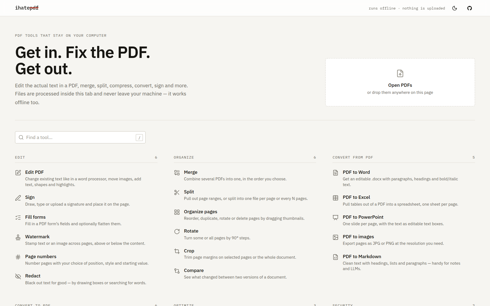
</picture>

</div>

---

## Why IHatePDF

- **Edit the actual text.** Double-click any paragraph and retype it, like in Word. The paragraph reflows in the document's own font, and the old characters are removed from the file, not hidden under a white box.
- **Compress to the size you need.** Choose a preset, or type a target like `2 MB` or `400 KB` and it finds the best quality that fits. For example, a 35 MB scan becomes 1.7 MB with no visible difference.
- **Your files never leave your computer.** There's no server and nothing to upload to. Every tool runs locally, and the app works with the network unplugged. The app keeps a small [usage log](#for-labs-the-usage-log) on the PC (tools, sizes, times, errors; never file names or content, never sent anywhere); you can turn it off in the footer.
- **Send files to a phone, offline.** Share files or whole folders to a phone with a QR code, over Wi-Fi, this PC's own hotspot or Bluetooth. Nothing goes through the internet. See [Share to phone](#share-to-phone).
- **Results save themselves.** When a tool finishes, the file saves after 5 seconds under a sensible name. Rename it during the countdown if you want. In the desktop app, files land in `Downloads\IHatePDF`.

<table>
  <tr>
    <td width="50%">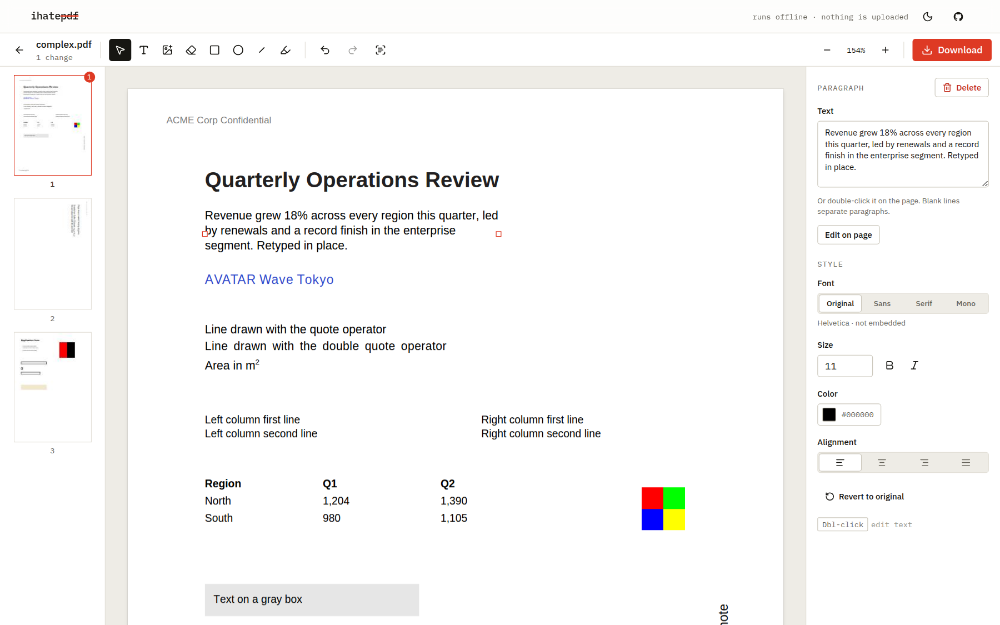<br><sub><b>Edit PDF</b> — retype a paragraph in place, change font, size, color and alignment.</sub></td>
    <td width="50%">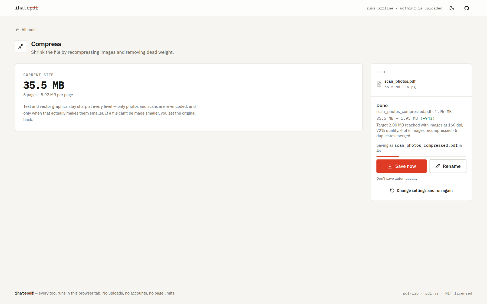<br><sub><b>Compress</b> — custom target: 35.5 MB → 1.95 MB for a 2 MB target, auto-saving in 4 s.</sub></td>
  </tr>
  <tr>
    <td width="50%">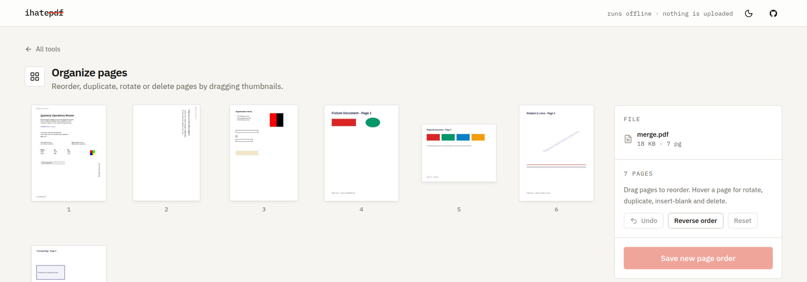<br><sub><b>Organize</b> — drag thumbnails to reorder, rotate, duplicate or delete pages.</sub></td>
    <td width="50%">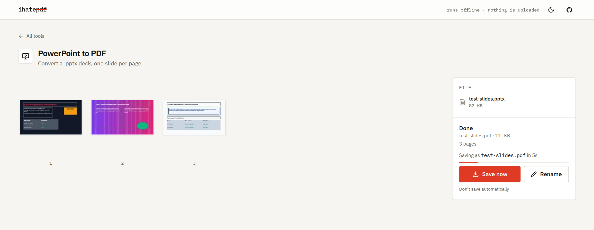<br><sub><b>Convert</b> — PowerPoint, Word, Excel, HTML and images to PDF, and back.</sub></td>
  </tr>
</table>

---

## Install on Windows

1. **[Download IHatePDF-Setup.exe](https://github.com/Burthcer/IHatePDF/releases/latest/download/IHatePDF-Setup.exe)** (about 130 MB).
2. **Run it.** Windows may say *"Windows protected your PC"*, because the installer isn't code-signed. Click **More info → Run anyway**.
3. **Click through the setup.** Windows asks once for administrator permission: the installer adds a Windows Firewall rule so phones can download from [Share to phone](#share-to-phone) without the app ever showing a network prompt. You can choose the install folder and whether you want desktop and Start-menu shortcuts.
4. **Open IHatePDF** from the desktop or the Start menu.

**Updating:** download the new setup and run it. It replaces the old version in place (1.1.0 and 1.2.0 included), and your saved files are never touched. The one exception: a 1.1.0 installed under a *different* Windows account stays in that account's *Settings → Apps*; uninstall it there.
**Uninstalling:** *Settings → Apps → IHatePDF → Uninstall*.

### System requirements

| | |
|---|---|
| **Windows** | Windows 10 or 11, 64-bit |
| **Memory** | 4 GB RAM works; 8 GB or more for PDFs over 500 MB |
| **Disk** | About 400 MB for the app, plus free space about the size of the file you're working on |
| **Install** | Administrator permission, once, during setup |

Need nothing but a browser? The same app runs as a web page. See [Run it in a browser instead](#run-it-in-a-browser-instead).

---

## Share to phone

Send files, or whole folders, from the PC to a phone. Nothing is uploaded anywhere and no app is needed on the phone. It's the first tool on the home screen.

1. **Add what to share:** files, folders, or both (buttons or drag and drop).
2. **Pick how the phone connects:**

| | Same Wi-Fi | PC hotspot (offline) | Bluetooth (offline) |
|---|---|---|---|
| **When to use it** | PC and phone are on the same Wi-Fi or network (internet not needed) | No Wi-Fi network at all: the PC's Wi-Fi card makes a private hotspot | No Wi-Fi at all |
| **On the phone** | Scan one QR code, tap Download | Scan a QR code to join the hotspot, then one to download | Open Bluetooth settings so it's visible, pick it in the app, tap Accept |
| **Phones** | Any (Android, iPhone) | Any (Android, iPhone) | Android only (iPhones can't receive files over Bluetooth) |
| **Size limit** | None | None | 4 GB, and slow (large files take minutes) |
| **Folders** | Download as a .zip | Download as a .zip | Sent as one .zip |
| **Needs** | A network | A PC with Wi-Fi | Bluetooth on the PC and the phone |

3. **Choose how long the QR code stays active** (1, 5 or 10 minutes; changing it restarts the countdown). The link stops working when time runs out, when you press **Stop sharing**, or when you close the app. If the app turned the hotspot on, it turns it off again.

With several items, the phone can download each one on its own or everything as one .zip. For Bluetooth, the app never picks a phone for you: you choose it from the phones it finds nearby.

<table>
  <tr>
    <td width="50%">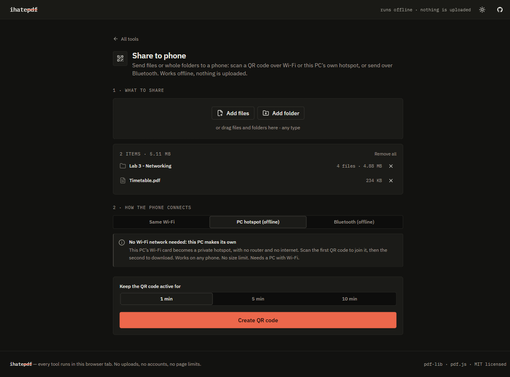<br><sub><b>Pick what to share and how</b>: a folder and a file, sent over this PC's own hotspot.</sub></td>
    <td width="50%">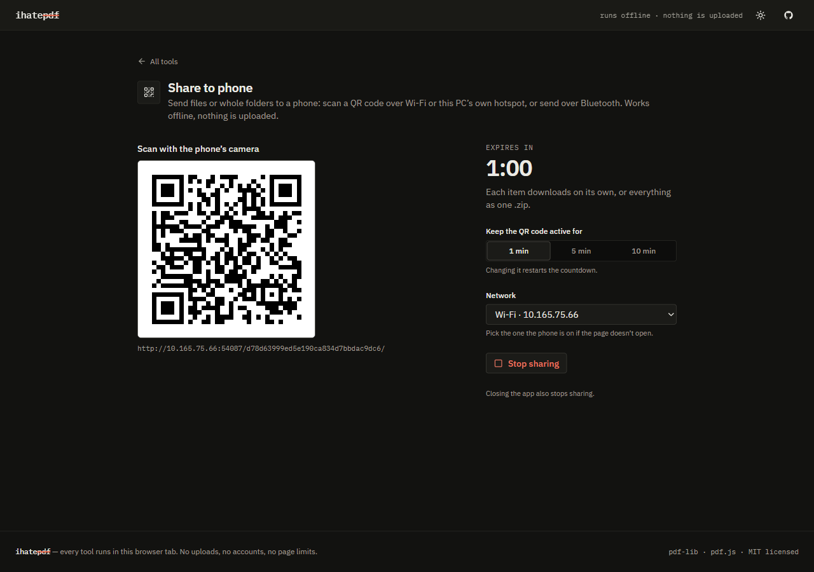<br><sub><b>Scan the QR code</b>: active for 1, 5 or 10 minutes.</sub></td>
  </tr>
  <tr>
    <td width="50%">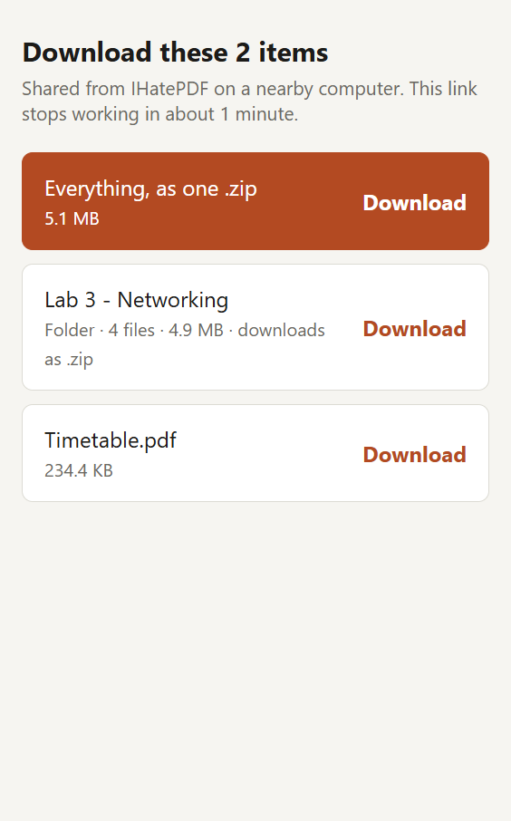<br><sub><b>On the phone</b>: download each item, or everything as one .zip.</sub></td>
    <td width="50%">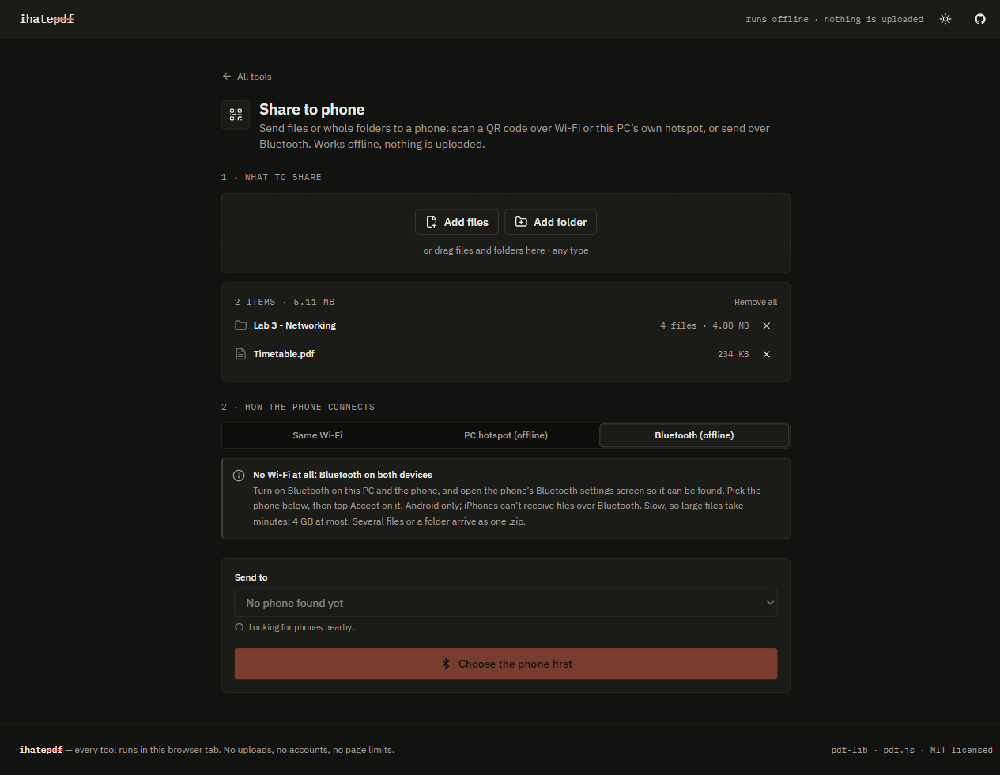<br><sub><b>Bluetooth</b>: finds nearby phones; nothing is chosen until you pick one.</sub></td>
  </tr>
</table>

Share to phone is only in the Windows desktop app; a browser tab can't run it.

---

## All 28 tools

| | Tools |
|---|---|
| ✏️ **Edit** | **Edit PDF** — retype text, move/resize/delete text and images, add text, images, shapes, highlights, whiteout · **Sign** — draw, type or upload · **Fill forms** · **Watermark** — text or image · **Page numbers** · **Redact** — draw boxes or search, removed for good |
| 🗂️ **Organize** | **Merge** · **Split** — ranges, every N pages, one file per page · **Organize pages** · **Rotate** · **Crop** · **Compare** — word-level diff plus visual overlay |
| 📤 **Convert from PDF** | **Word** — headings, lists, tables, bold/italic · **Excel** — detected tables · **PowerPoint** — editable text boxes · **JPG/PNG** — up to 600 dpi · **Markdown** |
| 📥 **Convert to PDF** | **Images** · **Word** · **Excel** · **PowerPoint** · **HTML** — real, selectable text · **Scan** — camera with perspective correction |
| ⚡ **Optimize** | **Compress** — Light / Balanced / Smallest or a custom size · **Repair** — recovers damaged and cut-off files · **PDF/A** — archival |
| 📱 **Share** | **Share to phone** — files and folders to a phone by QR code (Wi-Fi or this PC's hotspot) or Bluetooth, offline |
| 🔒 **Security** | **Protect** — AES-256 password, printing/copying limits · **Unlock** — RC4 and AES files you have the password for |

Password-protected PDFs work in every tool: you type the password once when you open the file.

---

## What's new in 1.4.0

| | 1.3.1 | **1.4.0** |
|---|---|---|
| **Word → PDF**, a Word file with a screenshot and a photo | both pictures dropped (text-only PDF) | **both kept**, with their original pixels |
| **Compress** a screenshot at *Balanced* | shrunk to 945 × 531, only 44% of its edge sharpness left | **kept sharp: 100%** |
| **Compress** a chart at *Balanced* | 81% | **100%** |
| **Compress** a scanned text page at *Balanced* | 220 KB | 220 KB (unchanged) |
| **Usage log** for labs | none | **local log, 15 MB cap, summary tool**, [see below](#for-labs-the-usage-log) |
| Rotate, Split… on a file **over 2 GB** | "Loading pages…" forever | **a clear message** |
| A **5 GB** file: Watermark · Merge · Protect · PDF/A · Compress | not tested | 86 s · 65 s · 62 s · 71 s · 743 s (about 1 GB of RAM, Compress 2.1 GB) |
| A **10,000-page** file | not tested | all 14 tools finished, 3 to 67 s (Redact on every page: 63 min) |
| Memory on a 4 GB PC | slows down instead of stopping | same |
| The app idle: memory · size installed | 390 MB · 416 MB | 397 MB · 416 MB |
| Automated checks | 80 | 85 |

Measured on Windows 11 with the installed app; smaller PCs simulated by their memory limit.

**Pictures in Word files now come through.** A .docx with screenshots used to become a PDF of text only. The pictures are now placed at the size Word gave them, scaled down only if wider than the page, without re-compressing them. (Pictures inside table cells are still left out.)

**Screenshots and charts stay sharp when compressed.** Compress treated every picture the same, so a screenshot pasted into Word, which is shown scaled down, lost half its pixels at 150 dpi and its text went soft. It now recognises screenshots and charts (mostly flat colour with sharp edges, not a full-page scan), gives them more resolution and quality than photos at the same setting, and stores them losslessly when that is smaller than a JPEG. Photos and full-page scans are compressed as before. *Custom size* warns when a target is so small that text in pictures may be hard to read.

**Files over 2 GB.** The app's page engine can't hold a 2 GB block of memory, so page previews can't open such files, and the tools that show pages (Rotate, Organize, Crop, Split, Edit PDF…) now say so instead of spinning. Merge, Compress, Watermark, Page numbers, Protect and PDF/A work on a 5 GB, 1,436-page scan.

**Known limits:** PDF → Word leaves out sideways text and can misplace pictures inside tables; PDF → Word on 10,000 pages needs about 4 GB of RAM; if Windows is almost out of memory Compress may stop with *"Windows is almost out of memory"*; scanned pages have no text (no OCR).

Full details and every measurement: [release notes](docs/RELEASE_NOTES.md) · [test report](docs/TEST_REPORT.md). Earlier versions: [all releases](https://github.com/Burthcer/IHatePDF/releases).

---

## For labs: the usage log

New in 1.4.0. The app keeps a small log **on the PC** of what it did, so a lab can measure how reliable and how heavy it really is: which tools are used, whether jobs succeed, how long they take, memory and CPU, and whether temp files are cleaned up.

- **Never uploaded.** It's a file on the PC; nothing is sent anywhere.
- **No file names, no document content.** Only the tool, sizes, times and results. Error messages have anything that looks like a file name removed. Users and PCs are anonymous ids (hashes).
- **Capped at 15 MB** (3 files of 5 MB). 15 days of normal use is a few hundred KB.
- **Switch it off** with *Turn off* in the footer (below), or `IHP_LOG=off`.
- **Deep Freeze labs:** point every PC at a shared drive with `%ProgramData%\IHatePDF\config.json`, so a restart can't wipe the log.

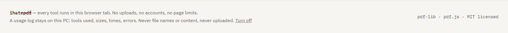

What a line of the log looks like. This is a Compress of a 50 MB scan (it worked, took 8.4 s and used 1.5 GB at most), and a damaged file that was refused (no file name in the log):

```json
{"ts":"2026-10-14T11:58:59Z","event":"job","tool":"compress","outcome":"ok","ms":8351,"inBytes":53409522,"outBytes":4231116,"ramPeakMB":1489,"appCpuPeak":1,"sysCpuPeak":34,"freeRamMinMB":9793,"tempFilesAtEnd":1}
{"ts":"2026-10-14T11:59:08Z","event":"job","tool":"watermark","outcome":"error","ms":332,"inBytes":48068569,"ramPeakMB":568,"errorClass":"damaged-file","errorText":"<file>\u201d is damaged — part of its structure can\u2019t be read. Open it in Repair PDF first, then use the repaired copy here."}
```

(Shortened; every line also has the anonymous PC, user and session ids.) `node scripts/log-summary.mjs <log folder>` turns the log into the tables a report needs: usage, success rate overall and per tool, error classes, times, RAM and CPU, temp-file clean-up (must be 0 left), and the log's own growth. From a short real session on 1.4.0:

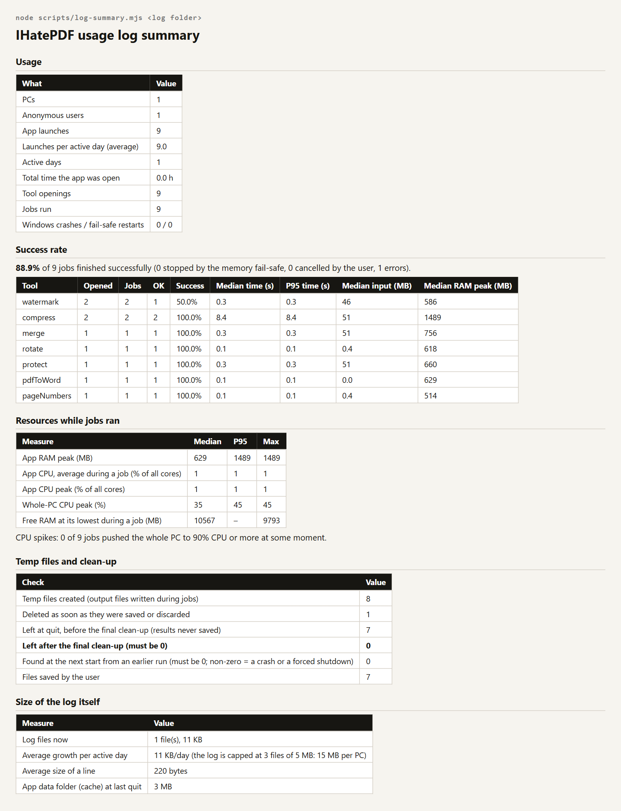

Everything it records, every setting, and how to check the PC over time (Day 1 / Day 10 / Day 15): [docs/USAGE_LOG.md](docs/USAGE_LOG.md).

---

## How it works

Everything runs on your machine:
- **[pdf-lib](https://pdf-lib.js.org/)** and **[pdf.js](https://mozilla.github.io/pdf.js/)** do the PDF work in Web Workers, so the window never freezes.
- The desktop app wraps the same code in Electron.

**The text editor** is a small PDF engine of its own (`src/features/editPdf/engine/`):
1. It reads each page's drawing instructions and works out every character's font, position and color.
2. It groups those characters into lines and paragraphs.
3. When you retype a paragraph, it removes the old characters from the page without moving anything else, then typesets your new text. It uses the original font when that font contains all the characters, and the closest match otherwise.

**The compressor** handles:
- every common image type in PDFs: JPEG, JPEG 2000, CMYK, color-profiled, palette, 16-bit and transparent;
- DPI-aware downsampling that uses each image's size *as displayed on the page*;
- merging duplicate images and dropping objects nothing uses.

It keeps a re-encoded image only if it actually got smaller. If the whole file can't shrink, you get the original back.

---

## Run it in a browser instead

Don't want to install anything? The same app runs as a web page:

```bash
git clone https://github.com/Burthcer/IHatePDF.git
cd IHatePDF
npm install
npm run dev          # then open the localhost link it prints
```

## More

- [Release notes for 1.4.0](docs/RELEASE_NOTES.md) · [The usage log](docs/USAGE_LOG.md)
- [Test results](docs/TEST_REPORT.md), and the [Windows test log](docs/testing/WINDOWS_TESTS.md)
- [For developers](HANDOFF.md): how the code is organized, building the installer, and releasing.

## License

[MIT](LICENSE). Free to use, modify and share.
