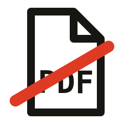
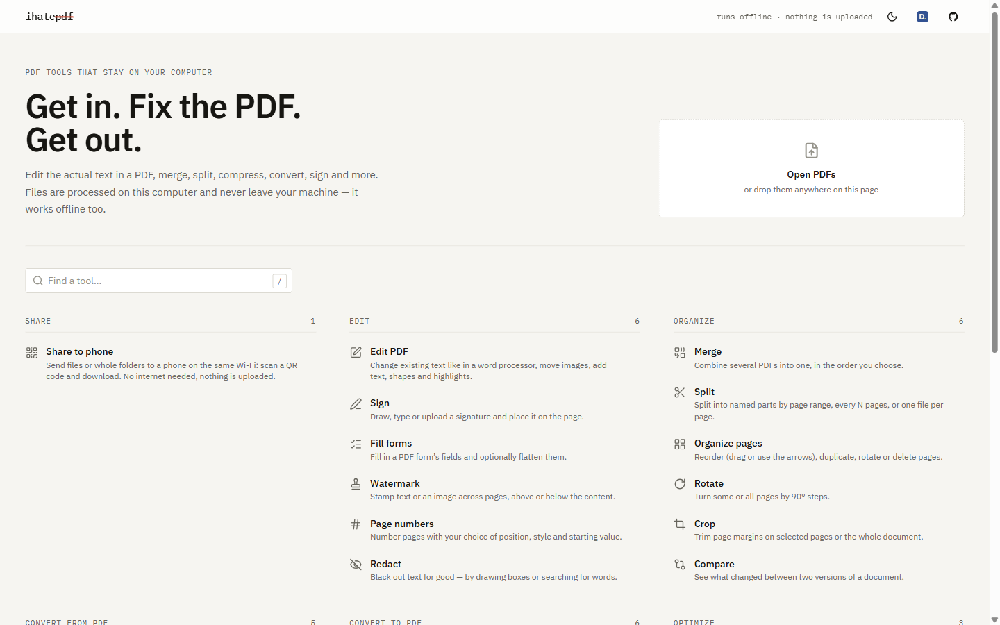
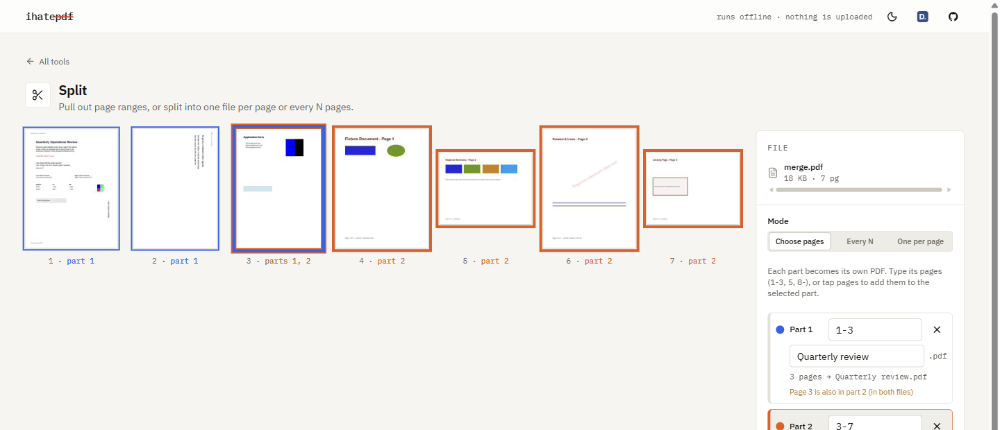
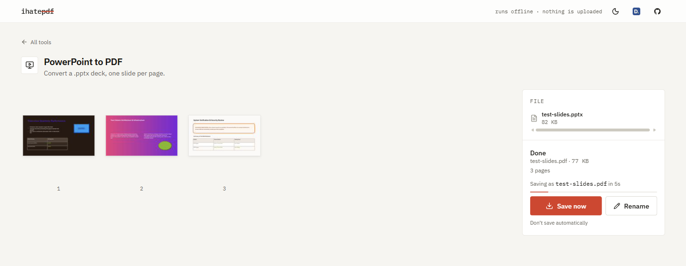
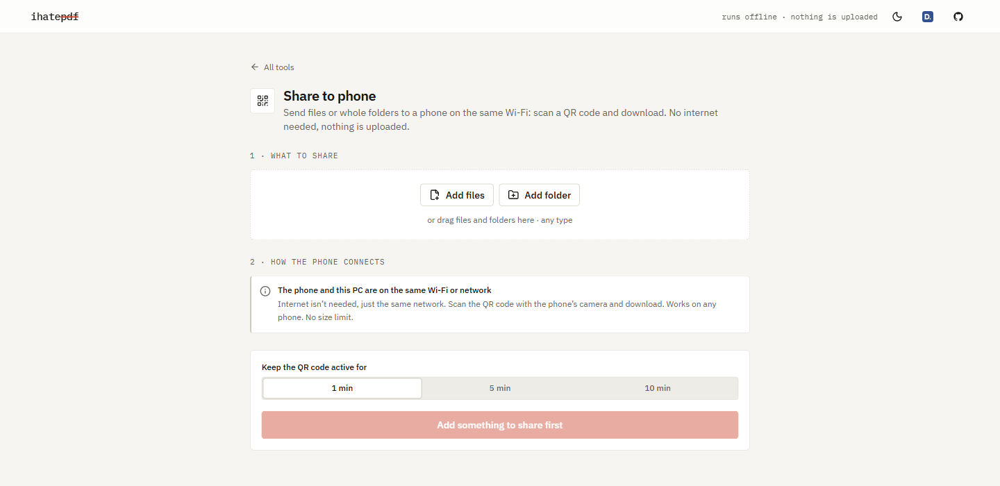

<div align="center">



# IHatePDF

**Edit, compress, convert and fix PDFs — on your own computer.**<br>
28 PDF tools, plus sending files to a phone over Wi-Fi. Real text editing. No uploads, no accounts, no watermarks, no AI.

[](https://github.com/Burthcer/IHatePDF/releases/latest/download/IHatePDF-Setup.exe)

[](https://github.com/Burthcer/IHatePDF/releases/latest)

[](LICENSE)

**New in [2.2.2](https://github.com/Burthcer/IHatePDF/releases/tag/v2.2.2):** the GitHub button in the app works again, and a new button links to [devbhamaria.com](https://devbhamaria.com). Older versions: [all releases](https://github.com/Burthcer/IHatePDF/releases).

<br>

<picture>
  <source media="(prefers-color-scheme: dark)" srcset="docs/screenshots/home-dark.png">
  
</picture>

</div>

---

## Why IHatePDF

- **Edit the actual text.** Double-click any paragraph and retype it, like in Word. The paragraph reflows in the document's own font, and the old characters are removed from the file, not hidden under a white box.
- **Compress to the size you need.** Choose a preset, or type a target like `2 MB` and it finds the best quality that fits. A 10 MB scan becomes 1.7 MB for a 2 MB target.
- **Split into named parts.** Give each part its own pages and file name; every page is outlined in its part's colour, and pages in two parts or in none are pointed out.
- **Your files never leave your computer.** There's no server and nothing to upload to. Every tool runs locally, and the app works with the network unplugged.
- **Send files to a phone.** Share files or whole folders to any phone on the same Wi-Fi with a QR code. Nothing goes through the internet. See [Share to phone](#share-to-phone).
- **Results save themselves.** When a tool finishes, the file saves after 5 seconds under a sensible name, into `Downloads\IHatePDF`. Rename it during the countdown if you want.

<table>
  <tr>
    <td width="50%"><br><sub><b>Edit PDF</b> — retype a paragraph in place, change font, size, color and alignment.</sub></td>
    <td width="50%"><br><sub><b>Compress</b> — custom target: 10.2 MB → 1.73 MB for a 2 MB target, saving itself in 4 s.</sub></td>
  </tr>
  <tr>
    <td width="50%"><br><sub><b>Split</b> — named parts, each in its own colour; page 3 is in both, so it's marked.</sub></td>
    <td width="50%"><br><sub><b>Organize</b> — drag thumbnails or use the arrows to reorder; rotate, duplicate or delete pages.</sub></td>
  </tr>
  <tr>
    <td width="50%"><br><sub><b>Convert</b> — PowerPoint, Word, Excel, HTML and images to PDF, and back.</sub></td>
    <td width="50%"><br><sub><b>Share to phone</b> — pick files or a folder, scan the QR code on the phone.</sub></td>
  </tr>
</table>

---

## Install on Windows

1. **[Download IHatePDF-Setup.exe](https://github.com/Burthcer/IHatePDF/releases/latest/download/IHatePDF-Setup.exe)** (about 28 MB).
2. **Run it.** Windows may say *"Windows protected your PC"*, because the installer isn't code-signed. Click **More info → Run anyway**.
3. **Click through the setup.** It installs for your Windows account only, so no administrator permission is needed. The first time you use [Share to phone](#share-to-phone), Windows asks once to let IHatePDF talk on your network; allow it so phones can download.
4. **Open IHatePDF** from the desktop or the Start menu.

**Updating:** download the new setup and run it; saved files are never touched. If you still have a 1.x version, uninstall it first from *Settings → Apps*.<br>
**Uninstalling:** *Settings → Apps → IHatePDF → Uninstall*.

### System requirements

| | |
|---|---|
| **Windows** | Windows 10 or 11, 64-bit |
| **Memory** | 4 GB RAM works; 8 GB or more for PDFs over 500 MB |
| **Disk** | About 100 MB for the app, plus free space about the size of the file you're working on |
| **Install** | No administrator permission (per-user install); needs the Microsoft Edge WebView2 runtime, which Windows 10 and 11 already include |

Need nothing but a browser? The same app runs as a web page. See [Run it in a browser instead](#run-it-in-a-browser-instead).

---

## All 28 tools

| | Tools |
|---|---|
| ✏️ **Edit** | **Edit PDF** — retype text, move/resize/delete text and images, add text, images, shapes, highlights, whiteout · **Sign** — draw, type or upload · **Fill forms** · **Watermark** — text or image · **Page numbers** · **Redact** — draw boxes or search, removed for good |
| 🗂️ **Organize** | **Merge** · **Split** — named, colour-coded parts with their own page ranges (one PDF each), every N pages, or one file per page · **Organize pages** · **Rotate** · **Crop** · **Compare** — word-level diff plus visual overlay |
| 📤 **Convert from PDF** | **Word** — headings, lists, tables, bold/italic · **Excel** — detected tables · **PowerPoint** — editable text boxes · **JPG/PNG** — up to 600 dpi · **Markdown** |
| 📥 **Convert to PDF** | **Images** · **Word** · **Excel** · **PowerPoint** · **HTML** — real, selectable text · **Scan** — camera with perspective correction |
| ⚡ **Optimize** | **Compress** — Light / Balanced / Smallest or a custom size · **Repair** — recovers damaged and cut-off files · **PDF/A** — archival |
| 📱 **Share** | **Share to phone** — files and folders to a phone on the same Wi-Fi, by QR code |
| 🔒 **Security** | **Protect** — AES-256 password, printing/copying limits · **Unlock** — RC4 and AES files you have the password for |

Password-protected PDFs work in every tool: you type the password once when you open the file.

---

## Share to phone

Send files, or whole folders, from the PC to a phone on the same Wi-Fi or network (the internet isn't needed). Nothing is uploaded anywhere and no app is needed on the phone; it works with Android phones and iPhones.

1. **Add what to share:** files, folders, or both (buttons or drag and drop).
2. **Choose how long the QR code stays active:** 1, 5 or 10 minutes.
3. **Scan the QR code with the phone's camera** and tap Download. With several items, the phone can download each one on its own or everything as one .zip; folders come as a .zip.

The link stops working when time runs out, when you press **Stop sharing**, or when you close the app. Share to phone is only in the Windows app; a browser tab can't run it.


---

## Built in Rust

Since 2.0 the app is a **Tauri** app (it uses Windows' own WebView2 instead of bundling a browser) with a **Rust core** (`crates/ihp-core`) doing most of the PDF work and **PDFium** drawing pages. Compared with the 1.4.0 Electron app:

| | 1.4.0 | 2.x |
|---|---|---|
| **Installer** | 124 MB | **28 MB** |
| **Compress**, 10 MB scan, click to result | 2.3 s | **0.8 s** |
| **Compress**, extra memory on that scan | +706 MB | **+130 MB** |
| **PowerPoint → PDF**, difference from PowerPoint's own PDF on real lecture decks (lower is closer) | 26.8 | **8.2** |

The original TypeScript engines are still inside as a safety net: when the Rust engine can't do a job, the old engine runs, so a file is never worse off. Full method and data: [benchmarks](docs/benchmarks/README.md).

---

## How it works

Everything runs on your machine:
- **The Rust core** does Compress, Merge, Split, Organize, Rotate, Crop, Redact, Watermark, Page numbers, Sign, Repair, Word / PowerPoint / Excel / HTML to PDF, PDF to PowerPoint and the Edit PDF engine. **PDFium** draws pages, thumbnails and PDF to JPG.
- **TypeScript engines** ([pdf-lib](https://pdf-lib.js.org/), [pdf.js](https://mozilla.github.io/pdf.js/) in Web Workers) run when the Rust engine declines a job, for password-protected files, and for Protect, Unlock, Forms, PDF/A and the Compare word diff. The browser version of the app uses them alone.
- **PowerPoint to PDF** is a DrawingML renderer (`crates/ihp-core/src/pptx`): theme and master inheritance, gradients, transparency, shadows, preset shapes, pictures (including SVG), tables, charts and the fonts installed on your PC.

**The text editor** is a small PDF engine of its own (`src/features/editPdf/engine/`):
1. It reads each page's drawing instructions and works out every character's font, position and color.
2. It groups those characters into lines and paragraphs.
3. When you retype a paragraph, it removes the old characters from the page without moving anything else, then typesets your new text, in the original font when it has all the characters and the closest match otherwise.

**The compressor** handles every common image type in PDFs (JPEG, JPEG 2000, CMYK, color-profiled, palette, 16-bit, transparent), downsamples each image based on its size *as shown on the page*, keeps screenshots and charts sharp, merges duplicate images and drops unused objects. It keeps a re-encoded image only if it got smaller; if the whole file can't shrink, you get the original back.

---

## Run it in a browser instead

Don't want to install anything? The same app runs as a web page:

```bash
git clone https://github.com/Burthcer/IHatePDF.git
cd IHatePDF
npm install
npm run dev          # then open the localhost link it prints
```

## More

- [Release notes](docs/RELEASE_NOTES.md) and [all releases](https://github.com/Burthcer/IHatePDF/releases)
- [Benchmarks and data](docs/benchmarks/README.md) · [Windows test log](docs/testing/WINDOWS_TESTS.md) · [2.0 test log](docs/testing/TEST_LOG.md)
- [For developers](HANDOFF.md): how the code is organized, building the installer, and releasing.
- The lab usage log was part of 1.4.0 only: [docs/USAGE_LOG.md](docs/USAGE_LOG.md).

## License

[MIT](LICENSE). Free to use, modify and share.
