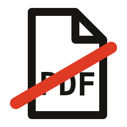
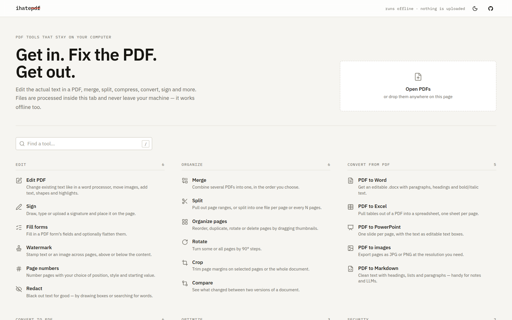
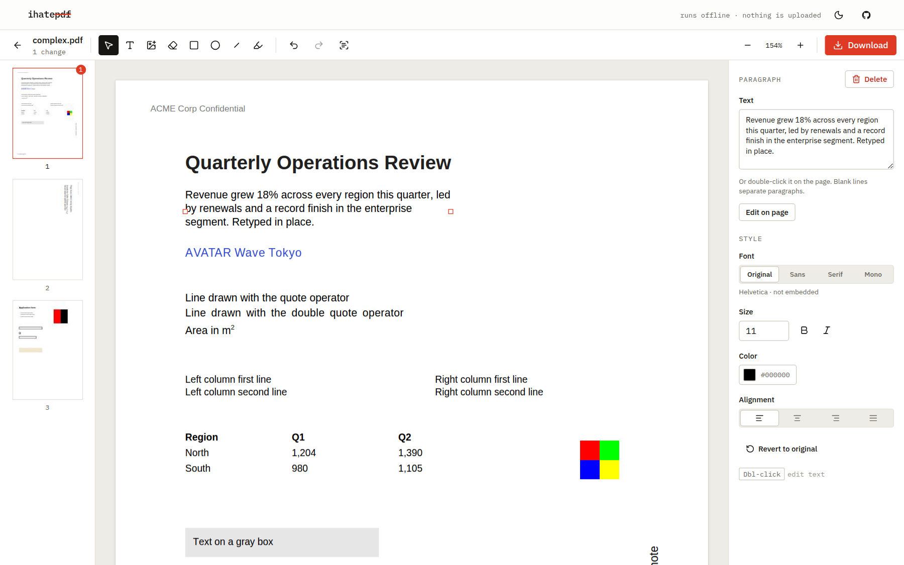
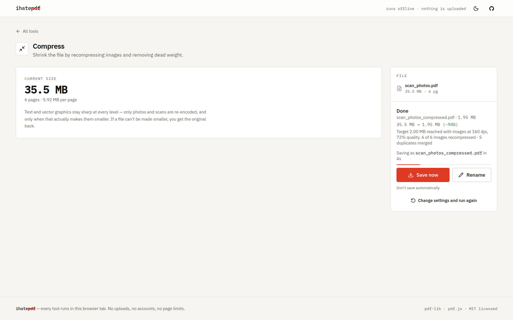
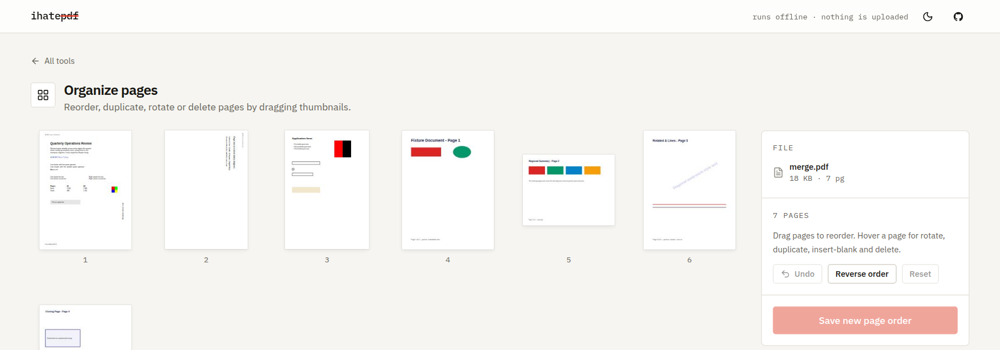
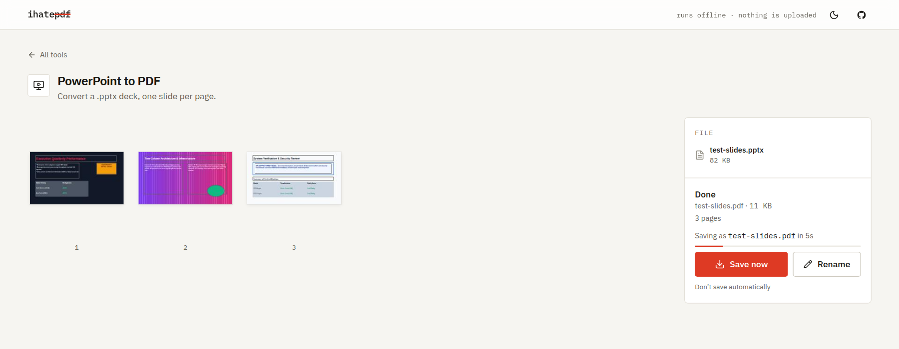

<div align="center">



# IHatePDF

**Edit, compress, convert and fix PDFs — on your own computer.**<br>
28 PDF tools. Real text editing. No uploads, no accounts, no watermarks, no AI.

[](https://github.com/Burthcer/IHatePDF/releases/latest/download/IHatePDF-Setup.exe)

[](https://github.com/Burthcer/IHatePDF/releases/latest)


[](LICENSE)

**New in 2.0.0:** rebuilt on Tauri with a Rust core. The installer is 24 MB instead of 130 MB, the app starts faster, and Compress and PDF to JPG run in Rust (Compress uses about a fifth of the memory). [What changed](#whats-new-in-200)

<br>

<picture>
  <source media="(prefers-color-scheme: dark)" srcset="docs/screenshots/home-dark.png">
  
</picture>

</div>

---

## Why IHatePDF

- **Edit the actual text.** Double-click any paragraph and retype it, like in Word. The paragraph reflows in the document's own font, and the old characters are removed from the file, not hidden under a white box.
- **Compress to the size you need.** Choose a preset, or type a target like `2 MB` or `400 KB` and it finds the best quality that fits. For example, a 35 MB scan becomes 1.7 MB with no visible difference.
- **Your files never leave your computer.** There's no server and nothing to upload to. Every tool runs locally, and the app works with the network unplugged.
- **Results save themselves.** When a tool finishes, the file saves after 5 seconds under a sensible name. Rename it during the countdown if you want. In the desktop app, files land in `Downloads\IHatePDF`.

<table>
  <tr>
    <td width="50%"><br><sub><b>Edit PDF</b> — retype a paragraph in place, change font, size, color and alignment.</sub></td>
    <td width="50%"><br><sub><b>Compress</b> — custom target: 35.5 MB → 1.95 MB for a 2 MB target, auto-saving in 4 s.</sub></td>
  </tr>
  <tr>
    <td width="50%"><br><sub><b>Organize</b> — drag thumbnails to reorder, rotate, duplicate or delete pages.</sub></td>
    <td width="50%"><br><sub><b>Convert</b> — PowerPoint, Word, Excel, HTML and images to PDF, and back.</sub></td>
  </tr>
</table>

---

## Install on Windows

1. **[Download IHatePDF-Setup.exe](https://github.com/Burthcer/IHatePDF/releases/latest/download/IHatePDF-Setup.exe)** (about 24 MB).
2. **Run it.** Windows may say *"Windows protected your PC"*, because the installer isn't code-signed. Click **More info → Run anyway**.
3. **Click through the setup.** You can choose the install folder and whether you want desktop and Start-menu shortcuts.
4. **Open IHatePDF** from the desktop or the Start menu.

**Updating:** download the new setup and run it. It replaces the old version in place (1.1.0 and 1.2.0 included), and your saved files are never touched. The one exception: a 1.1.0 installed under a *different* Windows account stays in that account's *Settings → Apps*; uninstall it there.
**Uninstalling:** *Settings → Apps → IHatePDF → Uninstall*.

### System requirements

| | |
|---|---|
| **Windows** | Windows 10 or 11, 64-bit |
| **Memory** | 4 GB RAM works; 8 GB or more for PDFs over 500 MB |
| **Disk** | About 40 MB for the app, plus free space about the size of the file you're working on |
| **Needs** | Microsoft Edge WebView2 (already part of Windows 10 and 11) |

Need nothing but a browser? The same app runs as a web page. See [Run it in a browser instead](#run-it-in-a-browser-instead).

---

## Share to phone

Not in 2.0.0 yet: it needs the Windows hotspot and Bluetooth code, which hasn't been moved to Rust. It returns in a later 2.x release; the 1.4.0 installer still has it. Every other tool is in 2.0.0.

---

## All 28 tools

| | Tools |
|---|---|
| ✏️ **Edit** | **Edit PDF** — retype text, move/resize/delete text and images, add text, images, shapes, highlights, whiteout · **Sign** — draw, type or upload · **Fill forms** · **Watermark** — text or image · **Page numbers** · **Redact** — draw boxes or search, removed for good |
| 🗂️ **Organize** | **Merge** · **Split** — ranges, every N pages, one file per page · **Organize pages** · **Rotate** · **Crop** · **Compare** — word-level diff plus visual overlay |
| 📤 **Convert from PDF** | **Word** — headings, lists, tables, bold/italic · **Excel** — detected tables · **PowerPoint** — editable text boxes · **JPG/PNG** — up to 600 dpi · **Markdown** |
| 📥 **Convert to PDF** | **Images** · **Word** · **Excel** · **PowerPoint** · **HTML** — real, selectable text · **Scan** — camera with perspective correction |
| ⚡ **Optimize** | **Compress** — Light / Balanced / Smallest or a custom size · **Repair** — recovers damaged and cut-off files · **PDF/A** — archival |
| 📱 **Share** | **Share to phone** — back in a later 2.x release (still in 1.4.0) |
| 🔒 **Security** | **Protect** — AES-256 password, printing/copying limits · **Unlock** — RC4 and AES files you have the password for |

Password-protected PDFs work in every tool: you type the password once when you open the file.

---

## What's new in 2.0.0

The desktop app is rebuilt on **Tauri** (the system's WebView2 instead of a bundled browser) with a **Rust core** (`crates/ihp-core`). Same screens, same tools.

| | 1.4.0 | **2.0.0** |
|---|---|---|
| Installer size | 130 MB | **24 MB** |
| Start to home screen | 1.19 s | **0.91 s** |
| App idle (all its processes) | 408 MB | 423 MB (about the same: the page itself is the same) |
| **Compress** a 10 MB scan (click to result) | 2.3 s | **0.8 s** |
| **Compress** peak extra memory on that scan | +706 MB | **+130 MB** |
| **Compress** a screenshot at *Smallest*: edge sharpness kept | 43% | **49%** (and sharper charts: 91% vs 76%) |
| **PDF to JPG** | pdf.js in the page | PDFium in Rust |
| Page thumbnails (Organize, Rotate, Split…) | pdf.js | PDFium in Rust |
| Merge · Split · Organize · Rotate · Crop · Images to PDF | in the page | in Rust |

**Compress quality is unchanged or better.** Screenshots and charts at *Light* and *Balanced* stay pixel-exact, photos score the same as before, and a Word file with a pasted screenshot and photo keeps both sharp. Images the Rust engine can't decode safely (JPEG 2000, CMYK, Lab and Separation colour, files over 1 GB) are handed to the previous engine, so nothing is worse than 1.4.0.

**Not in 2.0.0 yet:** Share to phone, the local usage log and the memory watchdog that restarts a stuck window (the page-side memory limits still apply). Word, PowerPoint, Excel and HTML to PDF, PDF to Word, Excel, PowerPoint and Markdown, Edit PDF, Sign, Forms, Watermark, Page numbers, Redact, Repair, PDF/A, Protect and Unlock still run on the same engines as 1.4.0 inside the new app; they move to Rust over the 2.x releases.

Details and every measurement: [release notes](docs/RELEASE_NOTES.md) · [test log](docs/testing/WINDOWS_TESTS.md). Earlier versions: [all releases](https://github.com/Burthcer/IHatePDF/releases).

---

## How it works

Everything runs on your machine:
- **Rust** (`crates/ihp-core`) does Compress, Merge, Split, Organize, Rotate, Crop, Images to PDF and page rendering (PDFium).
- **[pdf-lib](https://pdf-lib.js.org/)** and **[pdf.js](https://mozilla.github.io/pdf.js/)** do the rest in Web Workers, so the window never freezes.
- The desktop app is a **Tauri** shell around the same React app.

**The text editor** is a small PDF engine of its own (`src/features/editPdf/engine/`):
1. It reads each page's drawing instructions and works out every character's font, position and color.
2. It groups those characters into lines and paragraphs.
3. When you retype a paragraph, it removes the old characters from the page without moving anything else, then typesets your new text. It uses the original font when that font contains all the characters, and the closest match otherwise.

**The compressor** handles:
- every common image type in PDFs: JPEG, JPEG 2000, CMYK, color-profiled, palette, 16-bit and transparent;
- DPI-aware downsampling that uses each image's size *as displayed on the page*;
- merging duplicate images and dropping objects nothing uses.

It keeps a re-encoded image only if it actually got smaller. If the whole file can't shrink, you get the original back.

---

## Run it in a browser instead

Don't want to install anything? The same app runs as a web page:

```bash
git clone https://github.com/Burthcer/IHatePDF.git
cd IHatePDF
npm install
npm run dev          # then open the localhost link it prints
```

## More

- [Release notes for 2.0.0](docs/RELEASE_NOTES.md)
- [Test results](docs/TEST_REPORT.md), and the [Windows test log](docs/testing/WINDOWS_TESTS.md)
- [For developers](HANDOFF.md): how the code is organized, building the installer, and releasing.

## License

[MIT](LICENSE). Free to use, modify and share.
